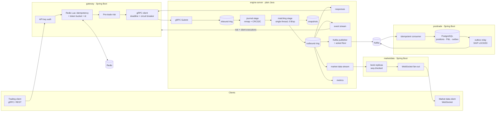

# Matchbook

A small but realistic electronic exchange in Java 25. At its core is a single-threaded,
allocation-free, price-time-priority matching engine on the LMAX Disruptor, with a memory-mapped
journal and snapshot recovery that survives `kill -9`. Around it, Spring Boot 4 services handle
order entry (gRPC and REST, Redis rate limiting and idempotency, pre-trade risk), market data
(WebSocket, sequenced snapshot plus incrementals) and post-trade (Kafka to PostgreSQL with a
transactional outbox). Everything is observable through Prometheus, Grafana and OpenTelemetry, and
runs with one Docker Compose command or a Helm chart on kind.

Every number below comes from a run recorded in [`docs/RESULTS.md`](docs/RESULTS.md), with the
command that produced it.

## Architecture



| Module | What it is |
|---|---|
| [`engine-core`](engine-core) | The order book and matching rules. No dependencies but Agrona, enforced by ArchUnit; deterministic; zero allocation |
| [`engine-pipeline`](engine-pipeline) | Disruptor wiring, memory-mapped journal (Java FFM), snapshots, crash recovery |
| [`engine-server`](engine-server) | The engine process: gRPC API, event and market data streams, Kafka publishing, metrics, tracing. No Spring |
| [`gateway`](gateway) | Order entry: gRPC, REST and FIX 4.4 (QuickFIX/J), API keys, Redis rate limit and idempotency, risk, Resilience4j |
| [`marketdata`](marketdata) | Book replicas and WebSocket feed (snapshot + sequenced incrementals), live book UI |
| [`posttrade`](posttrade) | Kafka → PostgreSQL positions and average-cost P&L, Flyway, transactional outbox, DLT |
| [`engine-bench`](engine-bench) | JMH benchmarks, open-loop latency generator (HdrHistogram, coordinated-omission corrected), recovery and snapshot timers |
| [`loadtest`](loadtest) | Gatling (Java DSL) end-to-end load test; market-maker and noise-trader bots |
| [`proto`](proto) | Protobuf/gRPC contracts shared by all services |
| [`deploy`](deploy) | Docker Compose, Helm chart, kind, Prometheus, Grafana dashboards as code, OTel collector |

## Run everything

Prerequisites: Docker with BuildKit (Docker Desktop, or Colima with the `docker-buildx` plugin) and
6–8 GB of memory for the VM; JDK 25 to build or benchmark outside Docker.

```bash
docker compose -f deploy/compose.yaml up -d --build
```

| What | Where |
|---|---|
| Order entry REST | http://localhost:8080/api/v1/orders |
| Order entry gRPC | localhost:9091 (`matchbook.v1.OrderEntry`, metadata `x-api-key`) |
| Order entry FIX 4.4 | localhost:9876 (TargetCompID `MATCHBOOK`, API key in `Password (554)` on Logon) |
| Live order book UI | http://localhost:8081 |
| Market data WebSocket | ws://localhost:8081/ws/market-data |
| Positions and P&L | http://localhost:8082/api/v1/positions/{clientId} |
| Grafana (dashboard "Matchbook overview") | http://localhost:3000 |
| Jaeger (traces gateway → engine → posttrade) | http://localhost:16686 |
| Prometheus | http://localhost:9090 |

Try it. The API keys are local placeholders: `local-dev-key-1`, `local-dev-key-2` and `local-dev-key-3`.

```bash
curl -s -X POST localhost:8080/api/v1/orders -H 'X-API-Key: local-dev-key-1' -H 'Content-Type: application/json' \
  -d '{"clientOrderId":"demo-1","symbol":"AAPL","side":"SELL","type":"LIMIT","price":"250.00","quantity":"100"}'
curl -s -X POST localhost:8080/api/v1/orders -H 'X-API-Key: local-dev-key-2' -H 'Content-Type: application/json' \
  -d '{"clientOrderId":"demo-2","symbol":"AAPL","side":"BUY","type":"MARKET","quantity":"40"}'
curl -s localhost:8082/api/v1/positions/2
```

Generate continuous flow for the dashboards:

```bash
./mvnw -q -pl loadtest -am compile && java -cp loadtest/target/classes dev.matchbook.loadtest.bots.Bots
```

On Kubernetes (kind):

```bash
brew install kind kubectl helm   # once
scripts/kind-up.sh               # creates the cluster, loads images, installs the chart, runs a smoke test
```

## Build and test

```bash
./mvnw verify                    # unit, property, golden-file, ArchUnit and Testcontainers tests
```

## Benchmarks

```bash
./mvnw -q install -DskipTests
java -jar engine-bench/target/benchmarks.jar MatchingEngineBenchmark -prof gc     # JMH + allocation
scripts/bench-matrix.sh                                                            # open-loop latency matrix
scripts/summarize-loadgen.py                                                       # tables for RESULTS.md
java -cp engine-bench/target/benchmarks.jar dev.matchbook.bench.SnapshotPauseTimer
./mvnw -pl loadtest gatling:test -Dgateway=http://localhost:8080 -Drate=200        # end to end, needs the stack
```

## Headline results

Measured on an Apple M5 laptop (macOS, no core isolation), JDK 25. Full tables, raw output and the
commands are in [`docs/RESULTS.md`](docs/RESULTS.md).

| What | Result |
|---|---|
| Matching cost, mixed workload (JMH) | **34.8 ns per command**, about 28.7 M commands/s on one core |
| Allocation on the matching path (JMH `-prof gc`) | **≈ 0 B/op** pooled, vs 56–112 B/op unpooled; enforced in CI |
| Full pipeline latency, journal + match + hand-offs, open-loop and coordinated-omission corrected, at 1 M commands/s | **p50 0.63 µs, p99 51 µs** (median of 3 runs) |
| Pooling vs not, at 1 M commands/s with G1 | p99 **55 µs vs 1.47 ms** |
| Fixing a synchronous 1 GiB journal segment roll, at 1 M commands/s | p99 **105 ms → 23 µs** |
| Restart: replay a 10 M-command, 800 MB journal | **1.10 s** (11.3 M commands/s); 0.49 s with a snapshot at 9 M |
| `kill -9` mid-stream | recovered state **byte-identical** to a fresh engine fed the journaled commands |
| End to end through the gateway (Gatling, open model, 4-vCPU Docker VM) | **2 136 req/s, 0 errors, p99 42 ms**; at 426 req/s p99 4 ms |
| Post-trade consistency after load | every symbol nets to 0; 5 786 trades applied exactly once |

The laptop's p99.9 and above are dominated by OS scheduling (RESULTS §1). That is reported as
measured, not filtered out.

## Documentation

- [`docs/DESIGN.md`](docs/DESIGN.md): order book structures and complexity, threading, recovery,
  failure modes, and what would change at a real exchange's scale.
- [`docs/RESULTS.md`](docs/RESULTS.md): every measurement, with hardware, JVM, flags and commands.
- [`docs/adr/`](docs/adr/README.md): sixteen architecture decision records.
- [`docs/PLAN.md`](docs/PLAN.md): the original plan.
