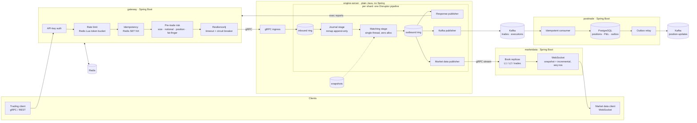

# Matchbook — Project Plan

> **Historical document.** This is the plan written and approved before any code existed, and it is
> kept unchanged as a record. What was actually built and measured is in the [README](../README.md),
> [`RESULTS.md`](RESULTS.md) and [`DESIGN.md`](DESIGN.md). Notable differences:
> - the Docker runtime turned out to be Colima, not Docker Desktop;
> - the FIX 4.4 gateway, bots and web UI were all built;
> - Gatling runs over REST.

A small but realistic electronic exchange in Java 25. The star is a single-threaded,
zero-allocation, price-time-priority matching engine. The surrounding Spring Boot services
handle order entry, risk, market data and post-trade, the way a real venue is structured.

This document is the plan to approve before any code is written. ADRs will record the
reasoning for each significant choice. This plan states the choice and a one-line reason.

---

## 1. Environment (checked on 2026-10-19)

| Item | Found | Notes |
|---|---|---|
| Machine | Apple M5, 10 cores, 16 GB RAM, macOS 26.6.2 | All benchmark numbers will be labelled "laptop, not isolated cores" |
| JDK | OpenJDK 25.0.4.1 (Homebrew) | Java 25 LTS |
| Maven | **not installed** | I'll commit a Maven Wrapper (`./mvnw`, Maven 3.9.x/3.10.0 pinned), so no global install is needed |
| Docker Desktop | 29.x, **4 CPUs / 5.8 GB** allocated | The full Compose stack (Kafka, Redis, Postgres, Prometheus, Grafana, OTel collector, Jaeger and 4 JVMs) needs about 5–6 GB. **Recommend raising Docker Desktop to 8 GB / 6 CPUs** |
| kind / kubectl / helm | **not installed** | Needed for milestone 6: `brew install kind kubectl helm` |
| git | 2.50.1 | |

## 2. Pinned versions (latest stable on Maven Central, checked 2026-10-19)

Spring-managed libraries follow the Spring Boot BOM. Everything else is pinned in the parent POM.

| Dependency | Version | Why / where |
|---|---|---|
| Spring Boot | 4.1.1 | gateway, marketdata, posttrade. Ships first-party gRPC starters |
| grpc-java | 1.83.1 (Boot-managed) | Same version used in the non-Spring engine-server so both sides match |
| protobuf-java | Boot-managed (4.3x) | `proto` module |
| LMAX Disruptor | 4.0.0 | engine pipeline |
| Agrona | 2.7.0 | primitive maps, `UnsafeBuffer`, mmap helpers, idle strategies |
| JMH | 1.37 | engine-bench |
| HdrHistogram | 2.2.2 | open-loop load generator, latency recording |
| OpenHFT Java-Thread-Affinity | 2026.2 | optional core pinning (Linux only, see risks) |
| JUnit | 6.x (Boot-managed) | |
| AssertJ / Mockito | 3.27.7 / 5.2x | |
| jqwik | 1.10.2 | property-based tests |
| ArchUnit | 1.5.1 | keep engine-core framework-free |
| Testcontainers | 2.0.5 | Kafka, Redis, Postgres IT |
| Resilience4j | 2.4.0 (`resilience4j-spring-boot4`) | gateway → engine |
| Kafka client | 4.2.1 (Boot-managed) | |
| Flyway | Boot-managed (12.x) | posttrade |
| OpenTelemetry | Java agent 2.x and SDK 1.6x | tracing |
| Gatling | 3.16.0 (Java DSL, `gatling-grpc-java`) | end-to-end load |
| QuickFIX/J | 3.0.2 | optional FIX gateway |

I'll re-check each version when I add it to the build.

## 3. Architecture

Observability, not drawn above: every service exposes Micrometer metrics to Prometheus, and
Grafana dashboards are provisioned from JSON in the repo. The OTel Java agent sends traces
through the OTel collector to Jaeger. The trace context crosses the engine's async hop by
being carried inside the command and copied into Kafka record headers.

## 4. Module layout (Maven multi-module)

| Module | Kind | Contents |
|---|---|---|
| `proto` | jar | `.proto` contracts: order entry, engine internal API, market data. Generated stubs |
| `engine-core` | jar, **no deps except Agrona** | Order book, matching, validation, self-trade prevention, object pools, event sink interface, snapshot codec. Deterministic and single-threaded |
| `engine-pipeline` | jar, plain Java | Disruptor wiring, command/event ring slots, mmap journal, snapshot scheduling, recovery, wait-strategy and affinity config |
| `engine-server` | executable jar, plain Java | gRPC server (grpc-java + Netty), Kafka producer, Micrometer → Prometheus endpoint, OTel |
| `engine-bench` | jar | JMH benchmarks; open-loop HdrHistogram load generator (corrects for coordinated omission) |
| `gateway` | Spring Boot | gRPC and REST order entry, auth, Redis rate limit and idempotency, risk, Resilience4j |
| `marketdata` | Spring Boot | Book replicas from the engine stream; WebSocket feed; optional web UI |
| `posttrade` | Spring Boot | Kafka → Postgres positions and P&L, Flyway, transactional outbox + relay |
| `loadtest` | jar | Gatling Java DSL simulations; optional market-maker and noise-trader bots |
| `deploy/` | not a module | `docker-compose.yml`, Helm chart, kind config, Prometheus, Grafana and OTel config |

**One change from the suggested split:** I'm adding `engine-pipeline` as its own module,
separate from `engine-server`. The open-loop benchmark and the recovery tests need the
Disruptor pipeline and journal *without* gRPC, Kafka or Netty on the classpath. That also
lets ArchUnit enforce two separate boundaries:
- `engine-core` depends on nothing but Agrona
- `engine-pipeline` has no networking

## 5. Key design decisions (each becomes an ADR)

1. **Single-threaded matching per shard.** Symbols are hashed to shards. Each shard has
   one matching thread, so the book needs no locks, results are deterministic and cache
   behaviour is predictable. Scaling comes from more shards, not more threads per book.
2. **LMAX Disruptor, two rings per shard.**
   - **Inbound ring:** journal handler → matching handler, gated on the journal sequence.
     Nothing is matched before it is journaled.
   - **Outbound ring:** the matching thread is the single producer. Publishers (responses,
     market data, Kafka) consume it in parallel.

   All allocation and I/O stays off the matching thread.
3. **Fixed-point `long` prices and quantities.** Each symbol has a price scale and a tick
   size. Notional is computed with `Math.multiplyHigh` overflow checks. No `double` or
   `BigDecimal` anywhere in the engine.
4. **Order book data structures:**
   - **Price ladder:** an array indexed by `(price − bandLow) / tick`, covering the
     symbol's static daily price band. Level lookup is O(1).
   - **Best-price search:** a `long[]` occupancy bitmap scanned with
     `Long.numberOfTrailingZeros`/`numberOfLeadingZeros`, 64 levels per word, so finding
     the next best price after a level empties is fast.
   - **Price levels:** each level is an intrusive doubly linked FIFO of pooled `Order`
     objects, with O(1) append, O(1) cancel and O(1) pop-front.
   - **Order-id lookup:** Agrona `Long2ObjectHashMap`, pre-sized, so put/get does not
     allocate.
   - **Trade-off:** the ladder only works because prices are bounded by the band, and the
     ADR will say so. The alternative is a sorted structure of active levels.
5. **Order semantics:**
   - Order types: limit (GTC for the session), market, IOC, FOK. FOK checks available
     quantity before any fill.
   - Cancel.
   - Cancel/replace: a quantity decrease at the same price keeps queue position; any
     price change or quantity increase loses it.
   - Self-trade prevention: cancel-resting by default, configurable to cancel-aggressor.
   - Validation: tick size, lot size, min/max quantity and the static price band.
6. **Determinism:**
   - No wall-clock time is read inside `engine-core`. Timestamps come in with the command.
   - Every output event gets a per-shard sequence number.
   - Same input → byte-identical output stream. Golden-file tests and the recovery test
     both assert this.
7. **Journal: hand-rolled memory-mapped append-only file, not Chronicle Queue.**
   - It's small (a few hundred lines) and I can fully explain it in an interview.
   - It avoids Chronicle's `--add-opens` and JDK-version coupling on Java 25.
   - It uses fixed-layout binary records written through Agrona `UnsafeBuffer`.
   - Durability is configurable: page cache only (survives a process crash) or `force()`
     every N records / N µs (survives an OS crash). Both are measured.
8. **Snapshots:**
   - A `SNAPSHOT` command flows through the inbound ring, so each snapshot sits at an exact
     journal sequence.
   - The matching thread serialises book state to a temp file, then renames it atomically.
   - Recovery loads the latest snapshot and replays the journal from `snapshotSeq + 1`.
   - The pause this causes is measured and documented.
9. **Wait strategies and affinity:** `BusySpin`, `Yielding`, `Sleeping` and `Blocking` are
   configurable per ring, and all of them are benchmarked. Thread pinning uses OpenHFT
   Affinity and works on Linux only. On macOS it is a logged no-op, stated plainly.
10. **Gateway transport:** external clients use gRPC (primary) and REST (convenience). The
    gateway calls the engine over gRPC:
    - unary submit/cancel/replace, with Resilience4j timeouts and a circuit breaker
    - a server stream of execution reports

    The ADR covers gRPC vs REST: HTTP/2 multiplexing, Protobuf, streaming and typed
    contracts.
11. **Redis:**
    - Token-bucket rate limiting as one atomic Lua script per request.
    - Idempotency: `SET NX` on `clientId:clOrdId` with a TTL, storing the first response,
      so a retry returns that same response.
    - The ADR covers sliding-window vs token-bucket, and fail-open vs fail-closed (the
      default will be fail-closed).
12. **Pre-trade risk in the gateway:** max order size, max notional, position limit and a
    fat-finger band against the last trade price.
    - **Positions:** the gateway keeps a live per-client view built from execution reports.
      On startup it seeds that view from posttrade at a known engine sequence.
    - **Position limit:** counts worst-case exposure, i.e. filled quantity plus open
      orders.
13. **Post-trade and the outbox:**
    - The engine journal is the source of truth. Kafka events are keyed and carry
      `(shard, seq)`, so after recovery the engine may republish, and consumers dedupe.
      The ADR calls this "journal as outbox".
    - posttrade applies each event once: a `processed_events` unique key and the
      positions/P&L update commit in the same Postgres transaction.
    - That transaction also writes `position-updates` rows to an `outbox` table. A relay
      using `SELECT … FOR UPDATE SKIP LOCKED` publishes them to Kafka with an idempotent
      producer.
14. **Market data:**
    - The engine streams L1, L2 and trade events with per-symbol sequence numbers to the
      marketdata service, starting with a book snapshot taken through the ring.
    - marketdata keeps replicas and serves WebSocket clients: first a snapshot with its
      seq, then incrementals. Clients detect gaps and re-request the snapshot.
15. **Metrics without polluting the hot path:**
    - The matching thread stamps `nanoTime` into output events. Publishers record latency
      into Micrometer timers with histograms.
    - Queue depth is read from Disruptor cursors by a metrics thread.

## 6. Testing strategy

- **engine-core unit tests (JUnit 5 + AssertJ):** every order type, partial fills, priority
  rules, cancel/replace priority, STP modes, each validation reject reason.
- **jqwik properties** over random command sequences:
  - the book is never crossed after a command completes
  - quantity is conserved: submitted = filled + resting + cancelled + rejected
  - price-time priority holds: fills come from the best price, oldest first
  - a cancelled order never fills
  - replaying the same input gives the same output
- **Golden-file scenario tests:** human-readable input files and expected-event files under
  `src/test/resources/scenarios/`.
- **ArchUnit:**
  - `engine-core` imports only `java.*` and `org.agrona.*`
  - `engine-pipeline` has no networking
- **Recovery test:**
  - Drive N random commands with snapshots in between, then capture full book state and
    the output stream.
  - Simulate a crash by abandoning the pipeline without a clean shutdown.
  - Recover from snapshot + journal and assert identical state and identical outputs.
  - Also test a truncated, half-written final journal record.
- **Testcontainers:** Redis (rate limit and idempotency), Kafka + Postgres (posttrade
  idempotency and outbox), and one end-to-end test through gateway → engine → Kafka → Postgres.
- **Allocation:** JMH `-prof gc` on the matching benchmarks, which must show ≈0 B/op.

## 7. Measurement methodology (no invented numbers)

- **JMH:** throughput and average time for add/cancel/match workloads, with ≥3 forks and
  warm-up iterations. Raw JSON output is committed under `docs/results/`.
- **Open-loop generator:**
  - Sends at a fixed target rate from a precomputed schedule.
  - Latency is measured from the **intended** send time, which corrects for coordinated
    omission, and recorded in HdrHistogram. Percentile output is committed.
- **Before/after comparisons:**
  - G1 vs generational ZGC (and Epsilon as a zero-GC control)
  - pooling on vs off
  - BusySpin vs Yielding vs Blocking
  - journal `force()` off vs on
- **Every table in `RESULTS.md`** lists the hardware, JVM version and flags, the exact
  command and the date.
- **Laptop caveat:** results come from a laptop with no core isolation, and `RESULTS.md`
  will say so. Comparisons between configurations on the same machine are what's
  meaningful, not the absolute numbers.

## 8. Milestones (each one compiles, passes all tests and is committed before moving on)

| # | Milestone | Exit criteria |
|---|---|---|
| 0 | Repo bootstrap | `git init -b main`, attribution settings, `commit-msg` hook, `.gitignore`, Maven wrapper, parent POM, empty modules build |
| 1 | Engine core | All order types, cancel and replace, STP, validation; unit, jqwik, golden and ArchUnit tests green |
| 2 | JMH + allocation | Benchmarks run; `-prof gc` ≈0 B/op on the matching path; first `RESULTS.md` |
| 3 | Pipeline + journal + recovery | Disruptor two-ring pipeline, mmap journal, snapshots, recovery test proving identical state; wait-strategy benchmarks; open-loop HdrHistogram generator with first numbers |
| 4 | Gateway + market data | gRPC/REST entry, auth, Redis rate limit and idempotency (Testcontainers), risk, Resilience4j; engine-server gRPC; marketdata WebSocket with snapshot + incremental |
| 5 | Post-trade | Kafka publisher, posttrade consumer, Flyway schema, idempotent apply, outbox + relay; Testcontainers ITs |
| 6 | Ops | Docker Compose one-command stack, Micrometer metrics, Grafana dashboards as code, OTel tracing to Jaeger, Helm chart verified on kind, Gatling simulation, GitHub Actions CI with a benchmark smoke run, GC and wait-strategy before/after numbers |
| 7 | Optional | Web UI, market-maker and noise-trader bots, then FIX 4.4 via QuickFIX/J if time allows |

Each milestone ends with a summary of what's done, the measured numbers and what's next.
Then the docs: README, ADRs, `DESIGN.md` and `RESULTS.md`.

## 9. Risks and honest limitations

- **Thread affinity does nothing on macOS.** macOS has no core-pinning API. Pinning will
  only be demonstrated on Linux, i.e. inside the Docker/kind VM, and that VM's vCPUs are
  not themselves pinned.
- **Laptop benchmarks are noisy**, from thermals and background processes. I'll report
  many forks and percentile distributions, not single best runs.
- **Docker Desktop memory:** 5.8 GB is tight for the full stack. JVM heaps will be capped,
  but 8 GB is recommended.
- **The journal is not replicated.** A real venue replicates its journal to a hot standby,
  which this project leaves out. `DESIGN.md` will discuss it as the main "at real scale"
  gap.
- **Gatling gRPC:** if `gatling-grpc-java` turns out not to work with Java 25 / Boot 4,
  I'll run the Gatling simulation over REST and say so.

## 10. Housekeeping

- No secrets in the repo. API keys and passwords in Compose and Helm will be obvious local
  placeholders (`changeme-local`), and `.env` files are git-ignored.
